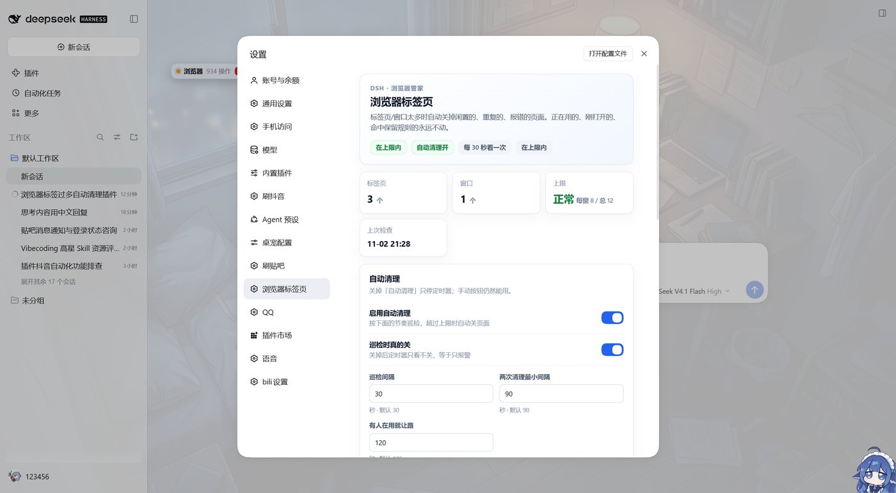

# dsh-browser-tabs

DSH 的浏览器标签页管家：DSH 专用 Edge（CDP 9227）里的窗口/标签页越积越多时，自动把闲置的、重复的、报错的、最老的关掉；正在看的、刚开的、命中保留规则的，一个都不动。

## 用途

- 浏览器标签页越开越多时自动收尾，不用手动一个个关。
- 超限后按「空白页 → 报错页 → 重复地址 → 最老的页面」的顺序关，每轮最多 3 个。
- 正在用的、2 分钟内新开的、每个窗口最新的、命中保留正则的页面不动；每个窗口至少留 1 个。
- 设置页能看当前标签页/窗口数、改阈值、预演一次或立即清理；手动清理默认先预演，不会一按就关。

### What it does (EN)

Keeps the DSH browser's tab count under configurable limits. When the per-window or total limit is exceeded, it closes blank, error, duplicate and oldest pages, while protecting the page in use, tabs opened in the last two minutes, the newest tab per window, keep-pattern URLs, and at least one tab per window. A settings panel provides thresholds, a dry-run preview and manual cleanup. It closes tabs only, not browser windows.

## 它怎么判断

每隔 `intervalMs`（默认 30 秒）看一眼，但两次真正动手之间至少隔 `cooldownMs`（默认 90 秒）。

超限条件（满足一个就算超）：

- 单个窗口超过 `maxTabsPerWindow`（默认 8）
- 全部窗口加起来超过 `maxTabsTotal`（默认 12）

超了之后按这个顺序挑，每轮最多 `maxClosePerRun`（默认 3）个：

1. 空白页 / 新标签页（`about:blank`、`edge://newtab`）
2. 报错页（`error.html`、`chrome-error`、`/404`）
3. 重复 URL（同一个地址开了多份，只留一份）
4. 最老的普通页

这些永远不动：

- 页面自己说可见 / 有焦点（`document.visibilityState`、`document.hasFocus()`）
- 2 分钟内新开的（`minAgeMs`）
- 每个窗口最新的 `keepRecentPerWindow` 个（默认 1）
- 窗口最小化时不再整窗保护：只保留有焦点的、最新的和至少 1 个；后台自动化 120 秒内还有操作仍然让路
- 命中 `keepPatterns` 的（默认保留 `douyin.com/?recommend=1`）
- 每个窗口至少留 `minTabsPerWindow` 个（默认 1）
- 浏览器服务 120 秒内还有操作（`$DSH_HOME/browser-service/ops.jsonl` 的 mtime），自动清理先让路
- 读不到“是否可见”时按“正在用”保守处理

## 两个工具

- `browser_tabs_status`：只读。看现在多少标签页/窗口、超没超、每个页面为什么被保留。
- `browser_tabs_clean`：默认 `dryRun=true`，只预演；`dryRun=false` 才真关。`force=true` 可以无视“浏览器刚被操作过”的保护。
  手动清理不受 `autoClose` 和冷却时间限制。

## 设置页

设置 → **浏览器标签页**。页面上能看当前标签页/窗口数、超没超上限、每个页面为什么被保留，也能直接改：

- 自动清理总开关、巡检时是否真的关
- 巡检间隔、两次清理冷却、有人在用就让路的时间窗
- 每窗口/合计上限、每轮最多关几个、新标签保护、每窗保留最新几个
- 保留正则（一行一个，命中就永远不关）

「保存设置」会写进 `$DSH_HOME/browser-tabs/settings.json` 并立刻重设定时器；启动时这份覆盖项优先于 `cordis.patch.yml` 的出厂默认。「预演一次」只算不动手，「立即清理」关之前会再确认。



## 配置

默认值在 `cordis.patch.yml`，改完保存会热重载；设置页保存的值在 `settings.json`，优先级更高。常用项：

| 键 | 默认 | 说明 |
| --- | --- | --- |
| `enabled` | true | 总开关；false 时巡检也不跑 |
| `autoClose` | true | false = 定时器只看不动手，只有手动工具能关 |
| `cdpUrl` | http://127.0.0.1:9227 | DSH 浏览器的调试口 |
| `maxTabsPerWindow` | 8 | 单窗口上限 |
| `maxTabsTotal` | 12 | 全部窗口上限 |
| `maxClosePerRun` | 3 | 每次最多关几个 |
| `minAgeMs` | 120000 | 新标签保护期 |
| `keepRecentPerWindow` | 1 | 每窗口保留最新的几个 |
| `keepPatterns` | 抖音推荐流 | 正则数组；命中就永远不关 |
| `intervalMs` / `cooldownMs` | 30000 / 90000 | 巡检间隔 / 动手冷却 |
| `activeGuardMs` | 120000 | 浏览器服务活跃就让路的时间窗 |
| `closeExtraWindows` | false | 预留：true 时才考虑关多余窗口（当前只报告，不关窗口） |

`maxWindows` 目前只作为配置保留，窗口合并没有默认开启——关窗口比关标签页重，先不自动做。

## 数据

都在 `$DSH_HOME/browser-tabs/`（本机是 `D:\dsh-data\browser-tabs`）：

- `state.json`：每个标签页第一次出现的时间、上次清理时间、累计关了几个
- `history.jsonl`：每次真关了页面的记录（时间、来源、关了哪些、剩多少）
- `settings.json`：设置页保存的覆盖项；删掉就回到 `cordis.patch.yml` 的默认值
- `boot.log`：插件每次加载写一行，用来确认装上了

## 安装 / 卸载

从插件市场：设置 → 插件市场，搜「浏览器标签页」或 `dsh-browser-tabs`。

从 GitHub 装：

```bash
dsh plugin --profile desktop add github:0changandui0/dsh-browser-tabs
```

装完把 `dsh-browser-tabs` 加进 profile 的 `dsh.profile.bundles`，热重载配置即可；设置页在「设置 → 浏览器标签页」。

临时关掉：把 `cordis.patch.yml` 里的 `enabled` 或 `autoClose` 改成 false，保存即可。
彻底卸载：从 profile 的 `dsh.profile.bundles` 删掉 `dsh-browser-tabs`，再删掉依赖和这个目录。

## 开发

```bash
cd dsh-browser-tabs
node --test test/policy.test.mjs test/settings.test.mjs
node --check index.js
node --check client.js
```

纯选择逻辑在 `lib/policy.mjs`，不碰网络/磁盘，可以单独测；设置读写/原子写在 `lib/settings.mjs`；CDP 在 `lib/cdp.mjs`；巡检在 `lib/keeper.mjs`；设置页在 `client.js`（浏览器半侧，注册 `settings.section`）。

改 `client.js` 后热重载插件、刷新页面即可；**新增/修改 `package.json` 的 `dsh.client` 声明不在热重载范围内**，DSH 会把包元数据缓存到下次重启。
